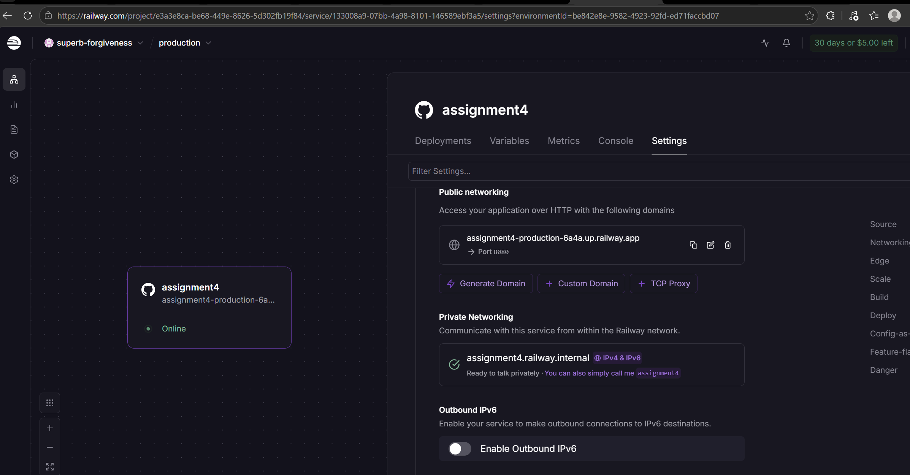

# TaskFlow API

TaskFlow API is a RESTful task management service built with **Spring Boot** and **Java 21**, containerized with a multi-stage Docker build, and deployed to production on **Railway**.

---

## Deployment & Live Verification

### Live Application URL
The API is deployed and accessible at:

```
https://your-app-name.up.railway.app/api/tasks
```
*(Update this URL with your active Railway deployment link)*

### Deployment Screenshots

#### 1. Railway Dashboard
Deployment status and active service overview on Railway:



#### 2. Live Application
API endpoint response verifying that the deployed service is active and handling requests:


---

## Project Status & Notes

### Deployment Status
- **Tasks Completed:** Multi-stage Docker containerization, local container testing, GitHub integration, and Railway cloud deployment.
- **Errors / Issues:** None.

### Stretch Goals (Optional)
- **Selection:** None
- **Notes:** Baseline assignment requirements completed.

---

## Architecture & Containerization

### Multi-Stage Dockerfile
To ensure a minimal image footprint and clean separation of concerns, the project uses a two-stage Docker build:

1. **Build Stage (`maven:3.9-eclipse-temurin-21`):** Resolves dependencies and compiles the application into an executable JAR (`mvn clean package -DskipTests`).
2. **Runtime Stage (`eclipse-temurin:21-jre-alpine`):** Copies solely the compiled JAR into a slim Alpine JRE image to run the service in production on port `8080`.

---

## Local Development & Testing

### Prerequisites
- Java 21 (JDK)
- Docker Desktop
- Maven (or use the included Maven Wrapper)

### Running with Maven
```bash
# Linux / macOS / WSL
./mvnw spring-boot:run

# Windows CMD / PowerShell
mvnw.cmd spring-boot:run
```
The application will start on `http://localhost:8080`.

### Building and Running via Docker
```bash
# Build the Docker image
docker build -t taskflow-api .

# Run container on port 8080
docker run -p 8080:8080 taskflow-api
```

---

## API Reference

| Method | Endpoint | Description | Request Body | Response |
| :--- | :--- | :--- | :--- | :--- |
| `GET` | `/api/tasks` | Get all tasks | None | `200 OK` |
| `GET` | `/api/tasks/{id}` | Get task by ID | None | `200 OK` |
| `POST` | `/api/tasks` | Create a new task | Task JSON | `201 Created` |

### Sample Payload (POST `/api/tasks`)
```json
{
  "title": "Complete Assignment 4",
  "description": "Containerize with Docker and deploy to Railway",
  "priority": "HIGH",
  "dueDate": "2026-10-20",
  "completed": false
}
```

### Testing Endpoints via cURL
```bash
# Retrieve all tasks
curl -X GET http://localhost:8080/api/tasks

# Create a new task
curl -X POST http://localhost:8080/api/tasks \
  -H "Content-Type: application/json" \
  -d '{"title":"Test task","description":"Testing API","priority":"HIGH","dueDate":"2026-10-20","completed":false}'
```

---

## Database Console (H2)
The in-memory H2 database console is enabled for local inspection at:
- **URL:** `http://localhost:8080/h2-console`
- **JDBC URL:** `jdbc:h2:mem:taskflowdb`
- **Username:** `sa`
- **Password:** *(empty)*
