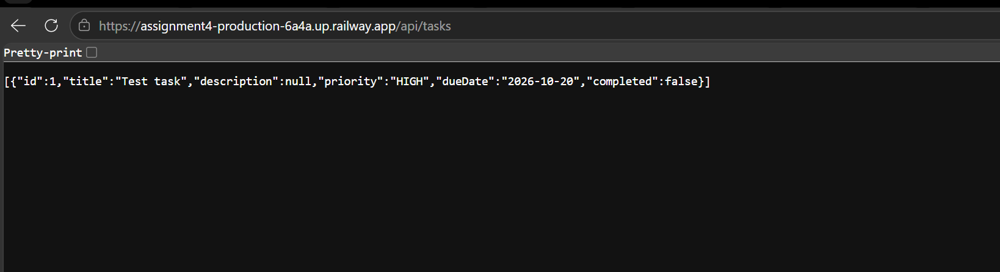

# TaskFlow API

TaskFlow API is a RESTful task management service built with **Spring Boot** and **Java 21**, containerized with a multi-stage Docker build, and deployed to production on **Railway**.

---

## Deployment & Live Verification

### Live Application URL
The API is deployed and accessible at:

```
https://assignment4-production-6a4a.up.railway.app/api/tasks
```

### Deployment Screenshots

#### 1. Railway Dashboard
Deployment status and active service overview on Railway:


#### 2. Live Application
API endpoint response verifying that the deployed service is active and handling requests:


---

## Project Status & Notes

### Deployment Status
- **Tasks Completed:** Multi-stage Docker containerization, local container testing, GitHub integration, and Railway cloud deployment.
- **Errors / Issues:** None.

### Stretch Goals (Optional)
- **Selection:** Option 1 (CI pipeline), Option 4 (versioned Docker images) and Option 5 (security checks)
- **Notes:** Baseline assignment requirements completed. All three share one workflow, [`.github/workflows/ci.yml`](.github/workflows/ci.yml), and each has a section below.

---

## Stretch goal: CI pipeline (Option 1)

I added a GitHub Actions workflow that runs on every push to `main` and on version tags. It has three jobs:

1. `test` runs `./mvnw verify`, which covers 10 unit and integration tests.
2. `security-scan` runs OWASP Dependency-Check and fails the build if any vulnerability scores 9.0 or higher on CVSS.
3. `docker` builds the image and pushes it to Docker Hub, but only if the first two jobs pass.

The Docker Hub login and the NVD API key are stored as GitHub Actions secrets (`DOCKERHUB_USERNAME`, `DOCKERHUB_TOKEN`, `NVD_API_KEY`), so none of them are in the code.

A successful run: https://github.com/alexong3579/assignment4/actions/runs/38417142859

Railway still redeploys on every push to `main`, so the two pipelines run side by side.

---

## Stretch goal: security checks (Option 5)

### Dependency scan

I used OWASP Dependency-Check 13.0.0 in the `security-scan` job. Each run uploads the full HTML report as the `dependency-check-report` artifact.

The first complete scan found one problem: `tomcat-embed-core` 11.0.24, which Spring Boot 4.1.1 pulls in by default. It had 11 known CVEs, and four of them were critical:

| CVE | CVSS |
| :--- | :--- |
| CVE-2026-65905 | 9.8 |
| CVE-2026-65637 | 9.8 |
| CVE-2026-68525 | 9.1 |
| CVE-2026-65182 | 9.1 |

Those four failed the build, which is what the 9.0 gate is for. The build log only gave scores for the critical ones, so the other seven are in the report artifact.

To fix it, I set `<tomcat.version>11.0.27</tomcat.version>` in `pom.xml`, which overrides the version Spring Boot picks. NVD lists the affected range as Tomcat 11.0.20 through 11.0.24, and 11.0.27 is the latest 11.0.x release. After the change the tests still passed and so did the scan.

### Secrets

No passwords, tokens or API keys are committed. The only hit when I searched the code was the H2 database password in `application.properties`, and that one is empty on purpose because the database is in memory. The CI credentials only exist as GitHub Actions secrets.

### What I left alone

- The build only fails at CVSS 9.0 and above. Lower-scoring findings still show up in the report, they just don't stop the build.
- I turned off the Sonatype OSS Index analyzer because it now needs credentials, so the scan only uses NVD data.
- I didn't scan the Docker image itself, only the dependencies. A tool like Trivy would be the next step.
- The H2 console is enabled (`spring.h2.console.enabled=true`), which means it can be reached on the public Railway URL. That's fine for a demo with no real data, but I would turn it off in a real deployment.

---

## Stretch goal: versioned Docker images (Option 4)

The images are on Docker Hub: https://hub.docker.com/r/alexong35/taskflow-api

I tag them with semantic versioning (MAJOR.MINOR.PATCH) and the git commit SHA. The CI pipeline does the tagging, so I never tag by hand.

| Tag | Where it comes from |
| :--- | :--- |
| `1.0.0`, `1.0.1` | Pushing a git tag like `v1.0.1` |
| `1.0` | The same git tag, and it moves to the newest patch release |
| `4bcc31f`, `857eedc`, ... | The short commit SHA of the commit that was built |
| `latest` | Every push to `main` |

Right now two versions are published. `1.0.0` was built from the Tomcat security fix (`857eedc`), and `1.0.1` was built from the commit after the README rewrite (`4bcc31f`), which is also what `latest` points at. To release a new version I run `git tag -a v1.0.2 -m "v1.0.2"` and `git push origin v1.0.2`, and the pipeline does the rest.

Docker Hub tags screenshot: *(add `screenshots/dockerhub-tags.png` here)*

---

## Architecture & Containerization

### Multi-Stage Dockerfile
To ensure a minimal image footprint and clean separation of concerns, the project uses a two-stage Docker build:

1. **Build Stage (`maven:3.9-eclipse-temurin-21`):** Resolves dependencies and compiles the application into an executable JAR (`mvn clean package -DskipTests`).
2. **Runtime Stage (`eclipse-temurin:21-jre-alpine`):** Copies solely the compiled JAR into a slim Alpine JRE image to run the service in production on port `8080`.

---

## Local Development & Testing

### Prerequisites
- Java 21 (JDK)
- Docker Desktop
- Maven (or use the included Maven Wrapper)

### Running with Maven
```bash
# Linux / macOS / WSL
./mvnw spring-boot:run

# Run the tests
./mvnw test

# Windows CMD / PowerShell
mvnw.cmd spring-boot:run
```
The application will start on `http://localhost:8080`.

### Building and Running via Docker
```bash
# Build the Docker image
docker build -t taskflow-api .

# Run container on port 8080
docker run -p 8080:8080 taskflow-api
```

---

## API Reference

| Method | Endpoint | Description | Request Body | Response |
| :--- | :--- | :--- | :--- | :--- |
| `GET` | `/api/tasks` | Get all tasks | None | `200 OK` |
| `GET` | `/api/tasks/{id}` | Get task by ID | None | `200 OK`, or `404` if not found |
| `POST` | `/api/tasks` | Create a new task | Task JSON (`title` required) | `201 Created`, or `400` if invalid |

### Sample Payload (POST `/api/tasks`)
```json
{
  "title": "Complete Assignment 4",
  "description": "Containerize with Docker and deploy to Railway",
  "priority": "HIGH",
  "dueDate": "2026-10-20",
  "completed": false
}
```

### Testing Endpoints via cURL
```bash
# Retrieve all tasks
curl -X GET http://localhost:8080/api/tasks

# Create a new task
curl -X POST http://localhost:8080/api/tasks \
  -H "Content-Type: application/json" \
  -d '{"title":"Test task","description":"Testing API","priority":"HIGH","dueDate":"2026-10-20","completed":false}'
```

---

## Database Console (H2)
The in-memory H2 database console is enabled for local inspection at:
- **URL:** `http://localhost:8080/h2-console`
- **JDBC URL:** `jdbc:h2:mem:taskflowdb`
- **Username:** `sa`
- **Password:** *(empty)*
